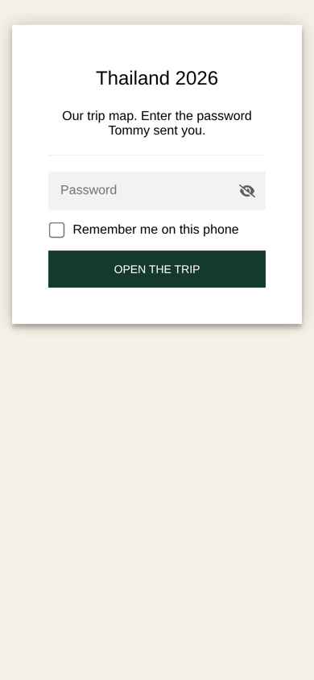
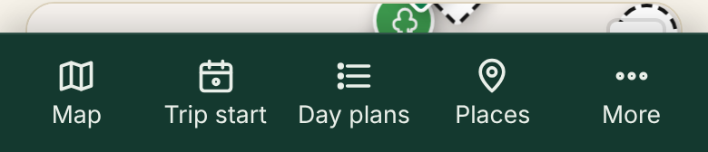
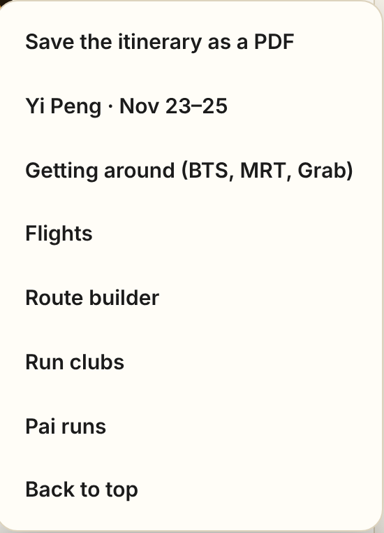
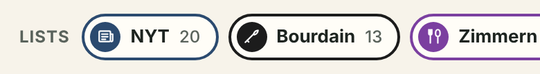
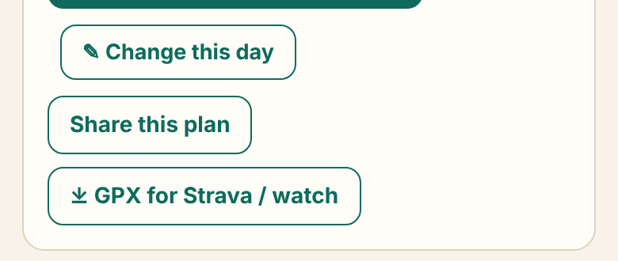
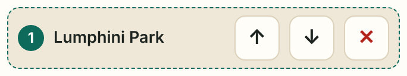
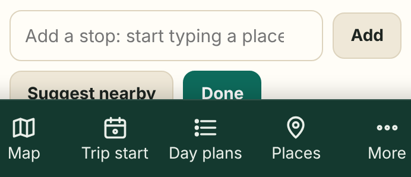
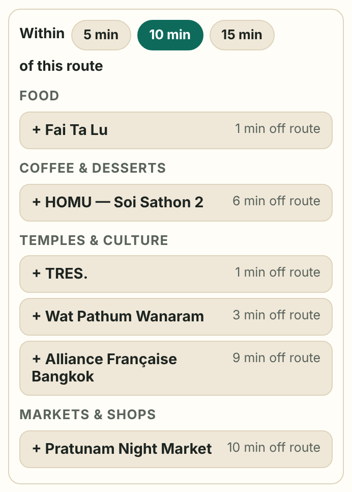
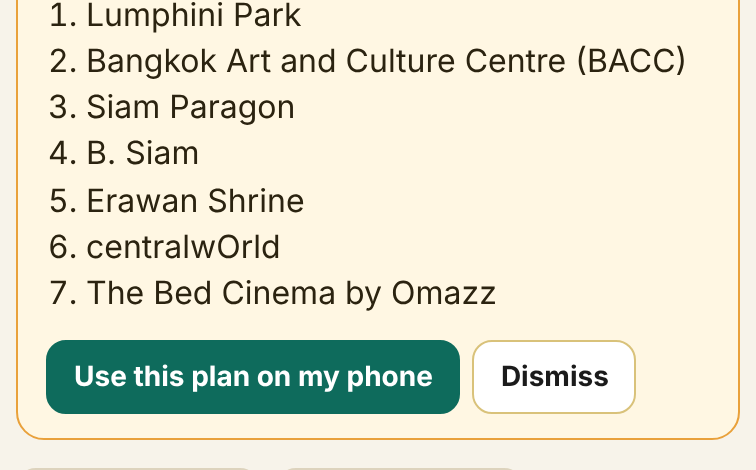

# Thailand 2026: our trip app

Our trip map and day plans, in one app on your phone. It's locked with a password, so only the people Tommy gives it to can open it. Everything below takes a minute or two.

**The app's address:** https://thomas-weston-adams.github.io/thailand-2026/

---

## 1. Open it and unlock it

1. Open the link above on your phone.
2. Type the password Tommy sent you.
3. Tick **Remember me on this phone**, so you only type it once.
4. Tap **Open the trip**.

---

## 2. Put it on your home screen

Then it opens like a normal app: its own icon, full screen, and it keeps working without a signal.

**iPhone (Safari)**
1. With the trip open, tap the **Share** button (the square with an arrow pointing up) at the bottom of Safari.
2. Scroll down and tap **Add to Home Screen**.
3. Tap **Add**. A green Thailand 2026 icon appears on your home screen.

**Android (Chrome)**
1. With the trip open, tap the **⋮** menu at the top right.
2. Tap **Add to Home screen** (it may say **Install app**).
3. Tap **Install** or **Add**.

> **Before you lose signal:** open the app once on Wi-Fi and look at the map in each city you're visiting. The app saves what you've looked at, so it still opens offline.

---

## 3. Getting around the app

On a phone, the bar along the bottom gets you anywhere in one tap.

| Button | What it does |
|---|---|
| **Map** | Jumps to the map and the place list |
| **Today** | Opens today's plan (it says **Trip start** before the trip) |
| **Day plans** | The full day-by-day itinerary |
| **Places** | The list of every place on the map |
| **More** | Flights, Yi Peng, getting around, the route builder, run clubs, Pai runs, and **Save the itinerary as a PDF** |

Each section folds up on a phone: tap its heading to open or close it. Each day in the day plans folds too, and today's day opens on its own.

---

## 4. The map and the lists

- Tap any pin, or any place in the list, to see its note, its address and an **Open in Google Maps** button for directions.
- The **Lists** buttons show only one list at a time: the **NYT** Bangkok guide, **Bourdain**, **Zimmern** or **Conan** spots. Tap the same button again to see everything.

---

## 5. Change a day's plan

Every day has three buttons:

Tap **✎ Change this day**, and then:

- **↑ ↓** move a stop earlier or later; **✕** takes it out.

  

- **Add a stop:** start typing a place name, pick it, and tap **Add**. (The place has to be on the map first.)
- **Undo all changes** puts the original plan back.
- **Done** when you're finished.

  

**Your changes stay on your own phone.** To show the other person, use **Share this plan** (step 7).

---

## 6. Suggest nearby

While changing a day, tap **Suggest nearby**. You'll see places from the map that sit close to that day's route, grouped into food, coffee and desserts, temples and culture, markets and more. Each one shows how many minutes' walk it is off the route.

- Pick how far you'll wander: **5, 10 or 15 min**.
- Tap any suggestion to add it. It goes into the plan at the spot along the route where it fits.

---

## 7. Share a plan

Tap **Share this plan**, and your phone's normal share menu opens (Messages, WhatsApp, email). It sends:

- the day's stops, as a list;
- a **Google Maps link** for the whole route;
- a link that opens **your version of that day** in the app.

When the other person opens that link, they see your plan with a choice:

**Use this plan on my phone** swaps it in on their phone too. **Dismiss** leaves theirs as it was.

---

## 8. A route for Strava or your watch

Tap **⤓ GPX for Strava / watch** on any day. You get a route file through that day's stops that follows real walking and running paths: streets, footpaths and park loops.

- **Strava:** in a web browser (not the Strava app), go to **strava.com → Dashboard → My Routes → Import GPX** and pick the file.
- **Garmin watch:** open the file with **Garmin Connect**, save it as a course, then **Send to Device**.

The route builder (under **More**) has its own GPX button, which also follows real paths.

> The path finder doesn't know about closures, construction or festival crowds. Glance at the route before you run it.

---

## 9. Save the whole itinerary as a PDF

**More → Save the itinerary as a PDF**. Choose **By day** or **By hotel**, then tap **Save as PDF**. On a phone, pick **Save as PDF** (or **Print → Save to Files**) in the menu that opens.

---

## For Tommy

- **Updating the app:** tell Claude what to change. The new version goes to the same link, and phones pick it up the next time the app is opened with a signal. If it looks old, close the app fully and open it again.
- **Changing the password:** ask Claude to re-lock the app with a new one, then send the new password to everyone. Old "remembered" phones will be asked for it once.
- **Removing someone's access:** change the password.
- **What's in this repo:** `index.html` is the whole app, locked. Without the password, it's scrambled text. `map/` holds the map engine, `sw.js` keeps the app working offline, `docs/` holds the pictures above, and the icon files are the home-screen icon.
